# Dépendances entre views, components et composables

Ce document décrit qui dépend de qui dans dailymon : 2 views, 18 components et 6 composables.
Le détail des props et des comportements de chaque composant se trouve dans [`COMPONENTS.md`](../COMPONENTS.md).

Les diagrammes sont écrits en [Mermaid](https://mermaid.js.org/). GitHub et VS Code (avec une extension Mermaid) les affichent directement.

**Sommaire**

1. [Vue d'ensemble](#1-vue-densemble)
2. [Arbre des composants](#2-arbre-des-composants)
3. [Qui utilise quel composable](#3-qui-utilise-quel-composable)
4. [Dépendances des composables](#4-dépendances-des-composables)
5. [État partagé et état local](#5-état-partagé-et-état-local)
6. [Props et événements](#6-props-et-événements)
7. [États d'un jour](#7-états-dun-jour)
8. [Scénarios](#8-scénarios)
9. [Points d'attention](#9-points-dattention)

## 1. Vue d'ensemble

Les dépendances descendent des views vers l'API. Une seule remonte et ne figure pas sur ce schéma : `customFetch` importe le routeur pour rediriger vers `/login` quand la session expire (voir le schéma de la section [Points d'attention](#9-points-dattention)).

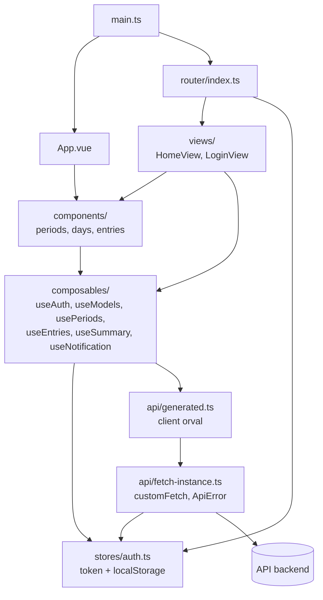

Trois règles structurent le code :

- Aucun composant n'appelle l'API. Les imports de `api/generated` dans `components/` sont des types, plus la constante d'enum `EntryFreeFoodDtoAllOfFoodType` dans `FreeEntryForm`.
- Il n'y a pas de couche service : les composables appellent directement `api/generated`.
- `types/entries.ts` et `utils/dates.ts` n'ont aucune dépendance vers les couches supérieures. Ils ne figurent pas sur le schéma pour le garder lisible.

| Module | Utilisé par |
|---|---|
| `types/entries.ts` | `useEntries`, `PeriodView`, `DayView`, `CategorySelection`, `FoodEntryPicker`, `EntryForm`, `EntryList`, `SportEntryCard`, `FreeEntryCard`, `FoodEntryCard`, `SportEntryForm`, `FreeEntryForm` (libellés `FOOD_TYPE_LABELS`, `BENEFIT_LABELS`, `SPORT_LABELS`) |
| `utils/dates.ts` | `usePeriods` (`PERIOD_DAYS`), `PeriodView` (`addDays`, `elapsedDaysDescending`, `PERIOD_DAYS`), `PeriodSummary` (`shortDate`), `DayView` (`weekDayName`, `shortDate`) |

## 2. Arbre des composants

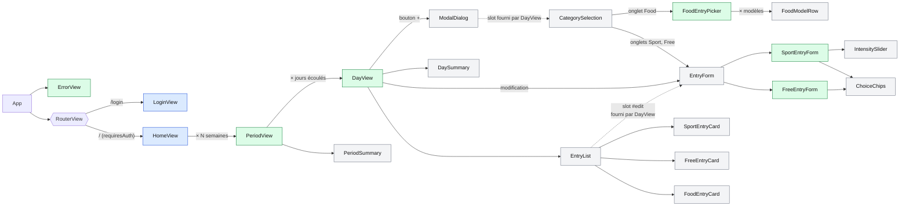

Bleu : views. Vert : composants qui utilisent au moins un composable. Gris : composants purement présentationnels, qui ne dépendent que de leurs props.

La saisie n'est plus affichée dans le jour : le bouton « + » de l'en-tête ouvre un `ModalDialog` qui contient `CategorySelection`, parent de `FoodEntryPicker` et de `EntryForm` selon l'onglet choisi.

Les formulaires n'ont qu'un parent, `EntryForm`. `EntryForm` est déclaré par `CategorySelection` pour la création et par `DayView` pour la modification. `DayView` l'injecte alors dans le slot `#edit` de `EntryList` : le formulaire s'affiche à la place de l'entrée, mais `EntryList` ne l'importe pas et ne connaît ni son état ni ses événements.

Les flèches en pointillés indiquent un contenu de slot : l'emplacement à l'écran, pas une dépendance. `ModalDialog` ne connaît pas `CategorySelection`, et `EntryList` ne connaît pas `EntryForm`.

Tous les composants de saisie sont dans `components/entries/` : `CategorySelection`, `FoodEntryPicker` et `FoodModelRow` servent à saisir des entrées, pas à gérer des modèles.

## 3. Qui utilise quel composable

Les views et le bandeau d'erreur :

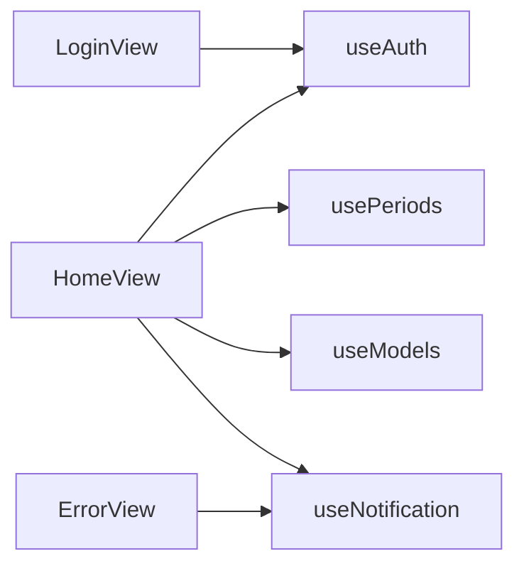

Les composants métier :

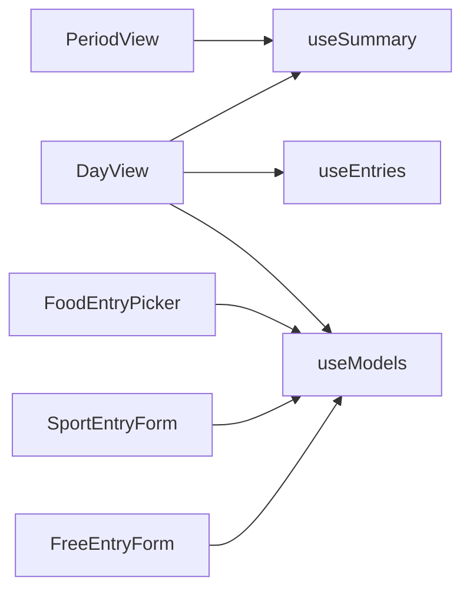

Le détail de ce que chacun consomme :

| Consommateur | Composable | Éléments utilisés |
|---|---|---|
| `LoginView` | `useAuth` | `doLogin` |
| `HomeView` | `useAuth` | `logout` |
| | `useNotification` | `clear` |
| | `useModels` | `foodModels`, `sportModels`, `freeModels`, `fetchModels`, `resetModels` |
| | `usePeriods` | `periods`, `fetchPeriods`, `loadAllPeriods` |
| `ErrorView` | `useNotification` | `message`, `tone`, `clear` |
| `PeriodView` | `useSummary` | `summary`, `fetchSummary` |
| `DayView` | `useEntries` | `entries`, `loaded`, `fetchEntries`, `addEntry`, `editEntry`, `removeEntry` |
| | `useSummary` | `summary`, `fetchSummary` |
| | `useModels` | `addFoodModelFromEntry` |
| `FoodEntryPicker` | `useModels` | `foodModels` |
| `SportEntryForm` | `useModels` | `sportModels` |
| `FreeEntryForm` | `useModels` | `freeModels` |

`App`, `PeriodSummary`, `DaySummary`, `ModalDialog`, `ChoiceChips`, `IntensitySlider`, `CategorySelection`, `FoodModelRow`, `EntryForm`, `EntryList` et les trois cartes d'entrée n'utilisent aucun composable.

## 4. Dépendances des composables

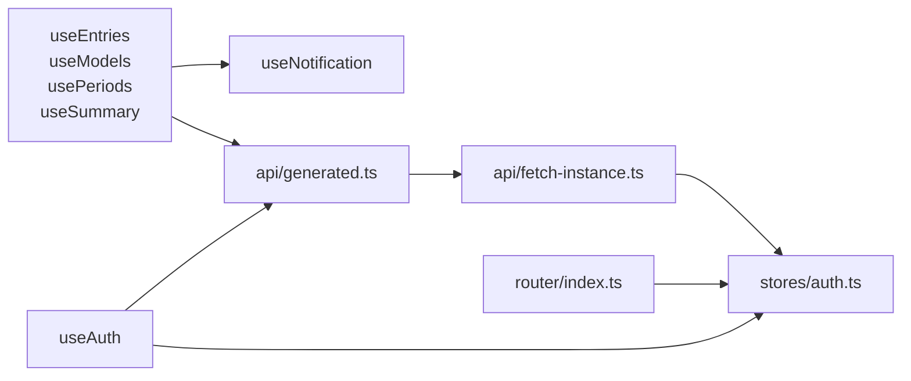

`useNotification` est le seul composable utilisé par d'autres composables, et il ne dépend de rien. `useAuth` ne l'utilise pas : les erreurs de connexion sont affichées par `LoginView`.

Le routeur et `customFetch` lisent directement le store `auth`, sans passer par `useAuth`.

| Composable | Portée de l'état | Fonction de l'API | Endpoint |
|---|---|---|---|
| `useAuth` | store Pinia `auth` | `login` | `POST /auth/login` |
| `usePeriods` | local à chaque appel | `getFirstDate` | `GET /entry/firstDate` |
| | | `getRelevantDates` | `GET /entry/get/{date}` |
| `useModels` | module | `getFoodModels` | `GET /model/food` |
| | | `getSportModels` | `GET /model/sport` |
| | | `getFreeModels` | `GET /model/free` |
| | | `createModel` | `POST /model` |
| `useEntries` | local à chaque appel | `getEntries` | `GET /entry/{date}` |
| | | `createEntry` | `POST /entry` |
| | | `updateEntry` | `PUT /entry/{id}` |
| | | `deleteEntry` | `DELETE /entry/{id}` |
| `useSummary` | local à chaque appel | `getSummaryInfo` | `GET /entry/summary-info` |
| `useNotification` | module | aucune | aucun |

## 5. État partagé et état local

L'emplacement du `ref` détermine le partage. Déclaré hors de la fonction `useX`, il est commun à toute l'application. Déclaré dedans, chaque appel crée le sien.

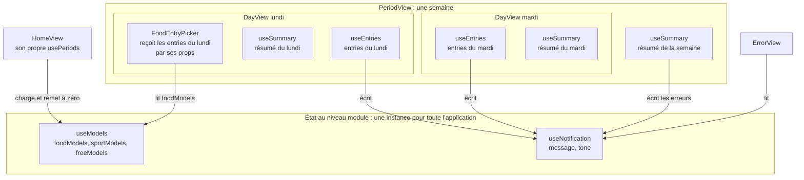

Conséquences pratiques :

- Le bouton « Create Model » de `EntryList` émet `@create-model`, et `DayView` ajoute le modèle à `foodModels`. Le compteur de `HomeView` et tous les `FoodEntryPicker` ouverts se mettent à jour sans rechargement.
- `HomeView` charge les modèles à son montage. Les formulaires lisent ensuite les listes sans déclencher d'appel.
- `resetModels` incrémente un compteur `session` : une réponse reçue après une déconnexion est ignorée.
- Les entrées d'un jour n'ont qu'une source : le `useEntries` de `DayView`, chargé une fois au montage puis mis à jour avec chaque DTO renvoyé par l'API.
- `ErrorView` est hors du `RouterView`, donc la notification reste visible lors d'un changement de route. `HomeView` l'efface à son montage. `notify(texte)` est un succès, qui s'efface seul au bout de 2,5 s ; `notifyError` et `notify(texte, 'error')` restent affichés jusqu'à ce qu'on les ferme.

## 6. Props et événements

Chaque flèche relie un parent, à gauche, à son enfant. Sur les libellés, `→` indique les données transmises par le parent, `←` les événements émis par l'enfant et `↔` un `v-model`.

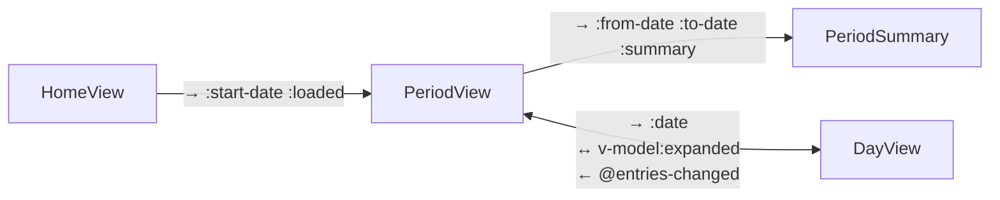

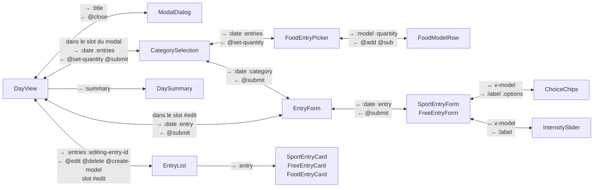

`DayView` centralise toutes les écritures : `EntryForm`, `FoodEntryPicker` et `EntryList` émettent, `CategorySelection` relaie, `DayView` appelle `useEntries`, ou `useModels` pour « Create Model ».

`DayView` détient aussi l'ouverture des formulaires : `creating` pour le modal de création, `editingEntryId` pour la modification. Chacun ne se referme qu'après un enregistrement réussi, si bien qu'une saisie refusée par le backend reste à l'écran. La saisie food garde le modal ouvert. `editingEntryId` est aussi remis à `null` quand le jour est replié. L'onglet courant, lui, est local à `CategorySelection` et repart sur Food à chaque ouverture du modal.

## 7. États d'un jour

Un jour a deux états indépendants.

- **Détail** (`expanded`) : `PeriodView` détient `expandedDay`, qui garantit qu'un seul jour est déplié par semaine. `DayView` le lit et l'écrit via `defineModel('expanded')`.
- **Saisie** (`creating`) : local à `DayView`. Le modal est modal, donc un seul est ouvert à la fois dans toute l'application.

Détail :

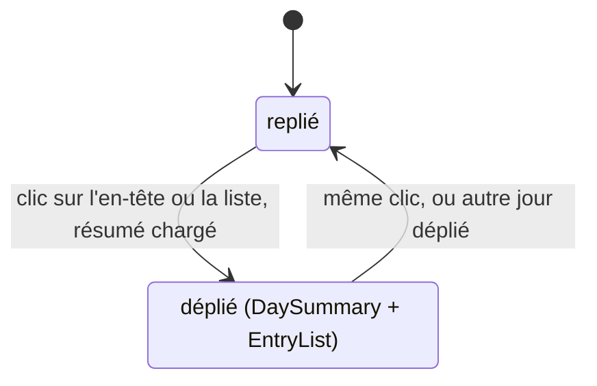

Saisie :

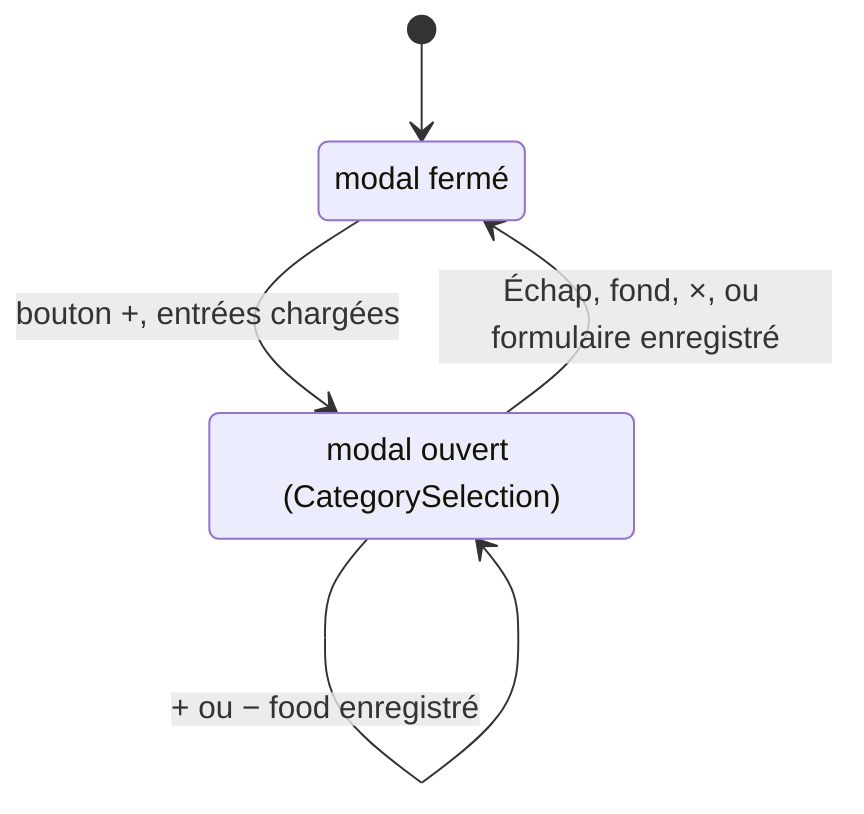

## 8. Scénarios

### Connexion

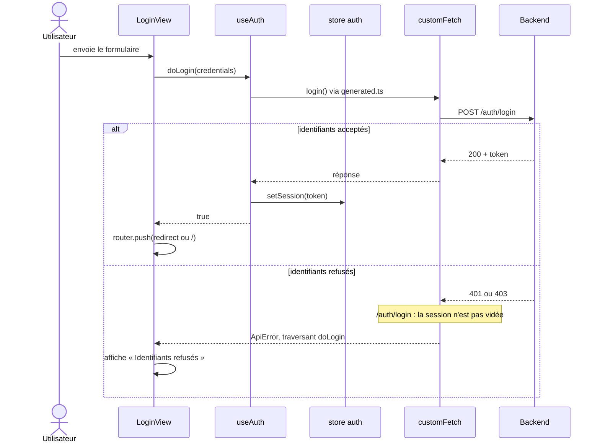

### Chargement de la page d'accueil

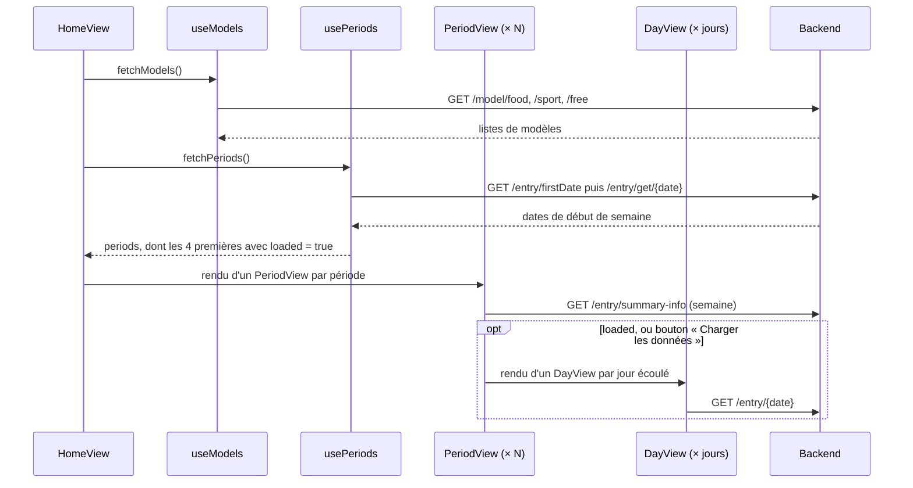

### Enregistrement d'une entrée sport ou free

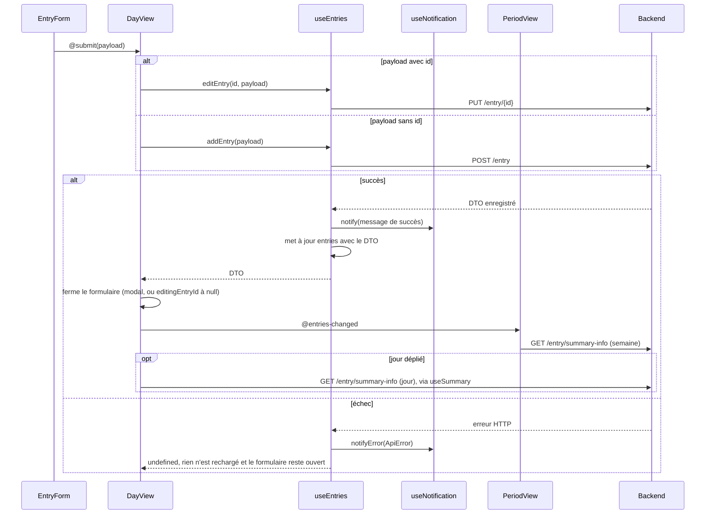

### « + » sur un modèle food

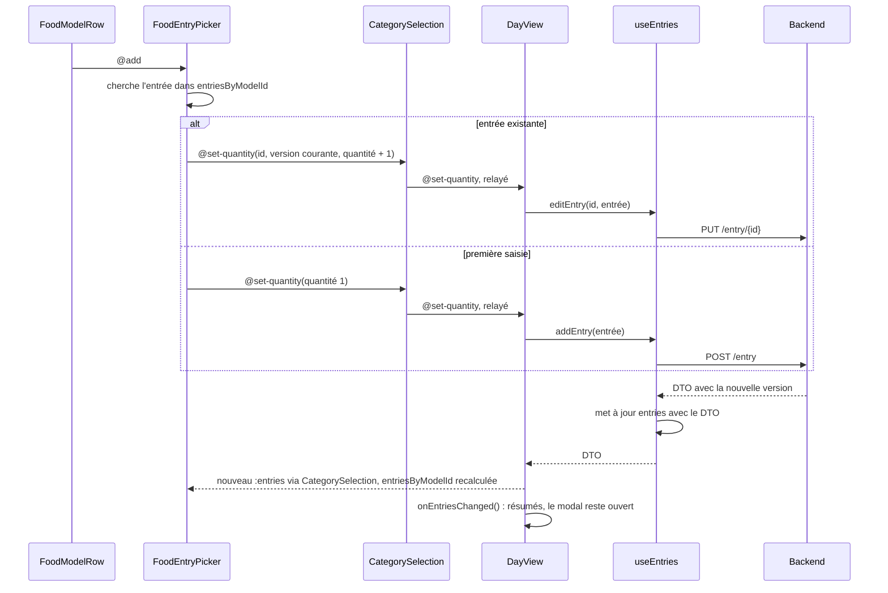

### Session expirée

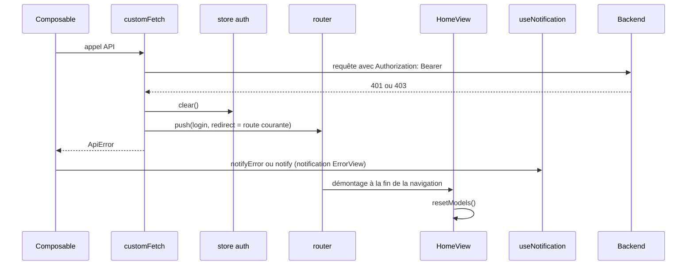

Le test `auth.isAuthenticated` dans `customFetch` évite une redirection par requête en cours : seule la première réponse 401 ou 403 vide la session.

## 9. Points d'attention

- **Import circulaire.** Il est sans effet aujourd'hui, car `router` et `customFetch` ne sont utilisés qu'à l'intérieur de fonctions, à l'exécution. Il ne faut donc pas les utiliser au niveau module dans ces fichiers.

  ```mermaid
  flowchart LR
      fetch["api/fetch-instance.ts"] --> router["router/index.ts"]
      router --> home["HomeView"]
      home --> auth["useAuth"]
      auth --> generated["api/generated.ts"]
      generated --> fetch
  ```

- **La saisie attend le chargement des entrées.** `DayView` n'affiche le bouton « + » qui ouvre le modal que lorsque `loaded` est vrai. Sans cela, le « + » d'un modèle food enverrait un `POST` au lieu d'un `PUT` pour un modèle déjà saisi. Si le chargement échoue, le bouton reste masqué jusqu'au rechargement de la page.
- **Les écritures dépendent du DTO renvoyé.** La liste n'est pas rechargée après une écriture : le backend doit continuer à renvoyer `model` et `version` dans ses réponses à `POST` et `PUT`.
- **Deux clics très rapides sur « + »** partent avec la même `version` si le premier n'a pas encore reçu sa réponse. Le second est alors signalé en erreur.
- **`useAuth` ne suit pas la convention d'erreurs.** `doLogin` laisse remonter l'`ApiError` et renvoie un booléen. C'est `LoginView` qui attrape l'erreur.
- **`removeEntry` renvoie un booléen**, alors que les autres mutations renvoient le DTO ou `undefined`.
- **Fonctions générées inutilisées.** `getModel`, `updateModel` et `deleteModel` sont générées mais jamais appelées.
